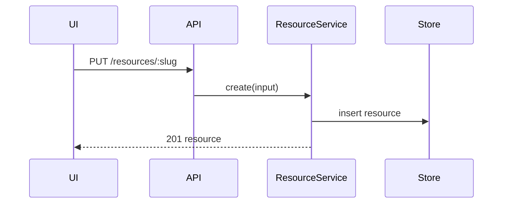

# 시스템 아키텍처

## 목적

서비스·엔드포인트·스키마·큐·저장소가 서로 어떻게 대화하는지 맞춘다.
함수 단위의 세부는 다루지 않는다 — 그건 프로그램 설계 단계다.

사람과 에이전트 사이의 대역폭을 최대로 올리는 게 목적이므로 시각화를 적극적으로 쓴다.

## 한 가지 경고

다이어그램은 **맞췄다는 착각**을 주기 쉽다. 그림이 그럴듯하게 나왔는데
정작 타입과 시그니처는 아무도 합의하지 않은 상태가 흔히 생긴다.
이 단계는 레버리지가 높고 모델의 나쁜 습관을 미리 차단할 수 있지만,
**이것만으로는 좋은 코드가 나오지 않는다.** 프로그램 설계 단계를 건너뛰지 않는다.

## 세 가지 산출물

### 1. 시퀀스 다이어그램

무엇이 무엇을 어떤 순서로 호출하는지.

````markdown

````

동기·비동기가 섞이거나 실패 경로가 중요한 경우에만 그린다.
호출이 일직선인 기능에 시퀀스 다이어그램을 그리는 것은 낭비다.

### 2. 계약 (엔드포인트 형태)

요청과 응답의 모양을 확정한다. 여기서 정하지 않으면 프론트와 백엔드가
서로 다른 것을 가정한 채로 만들어진다.

```text
PUT /api/resources/:slug
  request:  { destination: string }
  response: { resource: Resource }
  errors:   404 슬러그 없음 / 409 이미 존재함
```

에러 케이스를 빼지 않는다. 에러 경로는 나중에 붙이려고 하면 구조를 바꿔야 하는 경우가 많다.

### 3. 데이터 모델과 새 쿼리 형태

```sql
-- 새 테이블
CREATE TABLE resource (
  slug         TEXT PRIMARY KEY,
  destination  TEXT NOT NULL,
  created_at   TIMESTAMPTZ NOT NULL DEFAULT now()
);

-- 새로 생기는 쿼리 형태
-- SELECT slug, destination FROM resource WHERE created_at > $1 ORDER BY created_at DESC
```

스키마만 적고 쿼리 형태를 빼면, 인덱스가 필요한지 판단할 수 없다.

## 문서 템플릿

```markdown
## 시스템 아키텍처

### 현재 구조

[지금 관련 컴포넌트들이 어떻게 연결돼 있는지. 리서치 문서가 있으면 그 결론을 요약하고 링크한다.]

### 바뀌는 부분

[무엇이 새로 생기고 무엇이 바뀌는지, 컴포넌트 수준에서.]

### 흐름

[시퀀스 다이어그램 또는 번호 매긴 호출 순서]

### 계약

[엔드포인트별 요청/응답/에러]

### 데이터 모델

[새 테이블, 변경되는 컬럼, 새로 생기는 쿼리 형태]

### 검토한 대안

[다른 방식을 고려했다면 무엇이고 왜 택하지 않았는지 한두 줄씩.
나중에 "왜 이렇게 했나" 를 다시 묻지 않게 하는 데 이 섹션이 가장 효과가 좋다.]

### 되돌리기

[배포한 뒤 문제가 생기면 어떻게 되돌리는지. 마이그레이션이 있으면 특히.]
```

## 자주 나오는 실수

- **에러·실패 경로를 나중으로 미루기** — 구조를 바꿔야 하는 경우가 많다
- **대안을 적지 않기** — 몇 주 뒤 같은 논쟁을 처음부터 다시 하게 된다
- **다이어그램으로 끝내기** — 그림이 맞춰졌다고 시그니처가 맞춰진 것은 아니다
